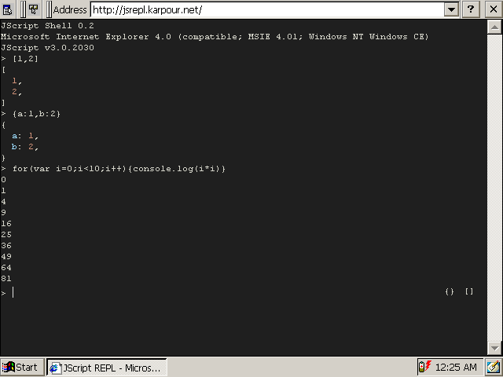

# JScript REPL

An in-browser REPL for JScript targeting Microsoft Pocket Internet Explorer 4.0. It will also work in Internet Explorer 4.0, however it is not optimized for it. Due to JScript quirks, it will only somewhat work in other old browsers like Netscape Navigator and modern browsers.

The REPL is similar to the REPL provided by nodejs and other js runtimes and provides object inspection and simple syntax highlighting.

A live version is available at [jsrepl.karpour.net](http://jsrepl.karpour.net)

If you do not own a Windows CE 3.0 handheld, I recommend using [CERF](https://cerf.cx) and creating a VM using the Jornada 720 or Siemens SimPad SL4 ROM. Follow [this guide](https://cerf.cx/articles/networking/) to connect the VM to the internet.

For discussions and suggestions, refer to the [HPC:Factor thread](https://www.hpcfactor.com/forums/forums/thread-view.asp?tid=21828)



## Building

This project is written in plain JS (JScript technically, which is mostly compatible) and can be built with various convenience functions built-in. By default, all convenience functions are included.

## Command history

The REPL has a history of 10 commands and abuses a cookie to save them across sessions.

## AJAX

Pocket Internet Explorer supports asynchronous XMLHTTP Requests. For this to work, the [Microsoft XML extension](https://www.hpcfactor.com/downloads/1503/XML_Update) needs to be installed.

## Error Handling

JScript 3.0 did not support try/catch yet, there was only a global exception handler available. If the script produces any errors, the global exception handler function will print the error.

## Convenience functions

### fetch

```javascript
/**
 * A wrapper for the XMLHTTPRequest
 * If the "Microsoft.XMLHTTP" ActiveX Object is not available, an error will be thrown
 * @param url URL to fetch
 * @param options Fetch options
 * @param options.method HTTP method, e.g. "GET"
 * @param options.body Request body
 * @param options.headers key-value object containing headers
 * @param success success callback function
 * @param failure failture callback function
 */
fetch(url, options, success, failure)
```

### JSON

```javascript
/**
 * Turns any JS value into a json string
 * @param value Value to stringify
 * @returns Stringified value
 */
JSON.stringify(value)

/*
 * Parses valid JSON
 * @param jsonString Stringified JSON to parse
 * @returns parsed vlue
 */
JSON.parse(jsonString)
```

### Benchmark

```javascript
/**
 * Executes passed function a number of times and returns the elapsed time in ms
 * @param fn function to benchmark
 * @param iterations Number of iterations to run fn
 * @returns elapsed time
 */
benchmark(fn, iterations)
```

